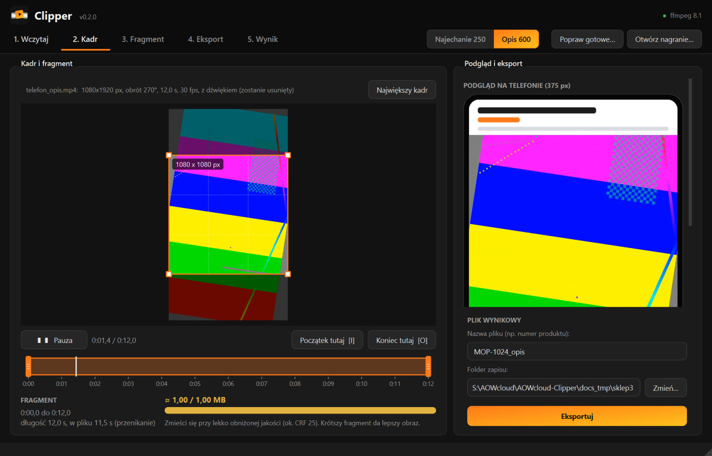
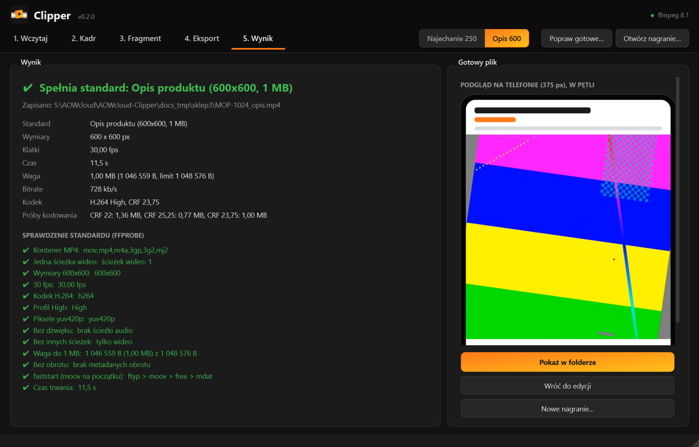
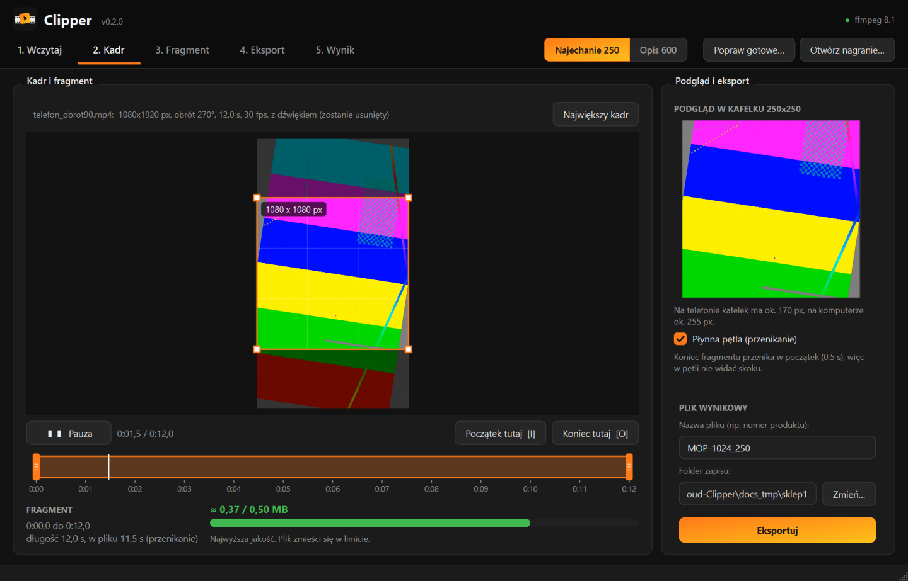
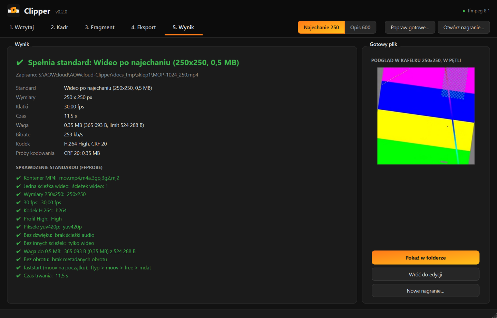
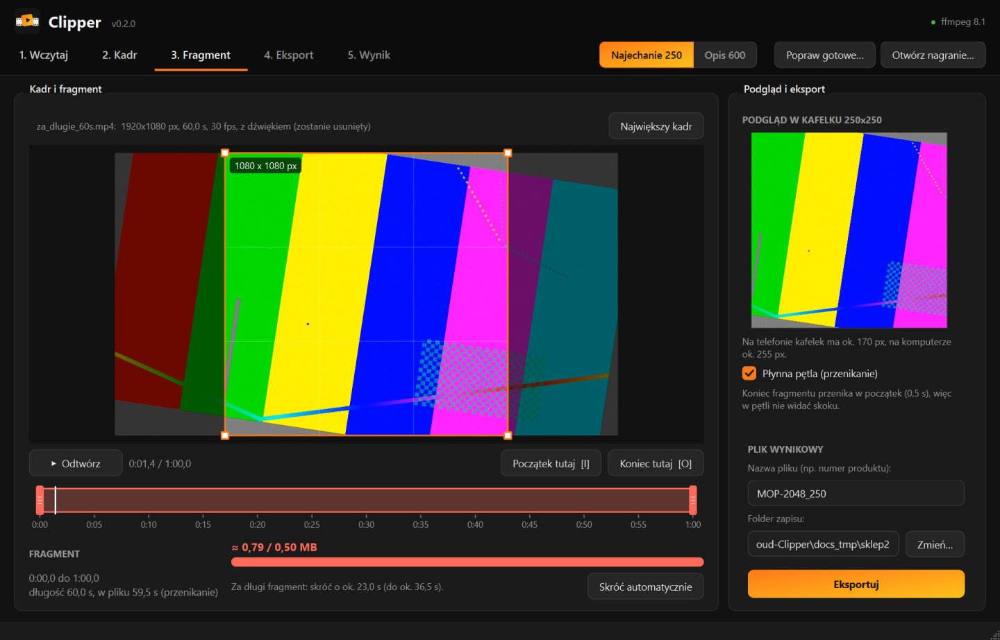
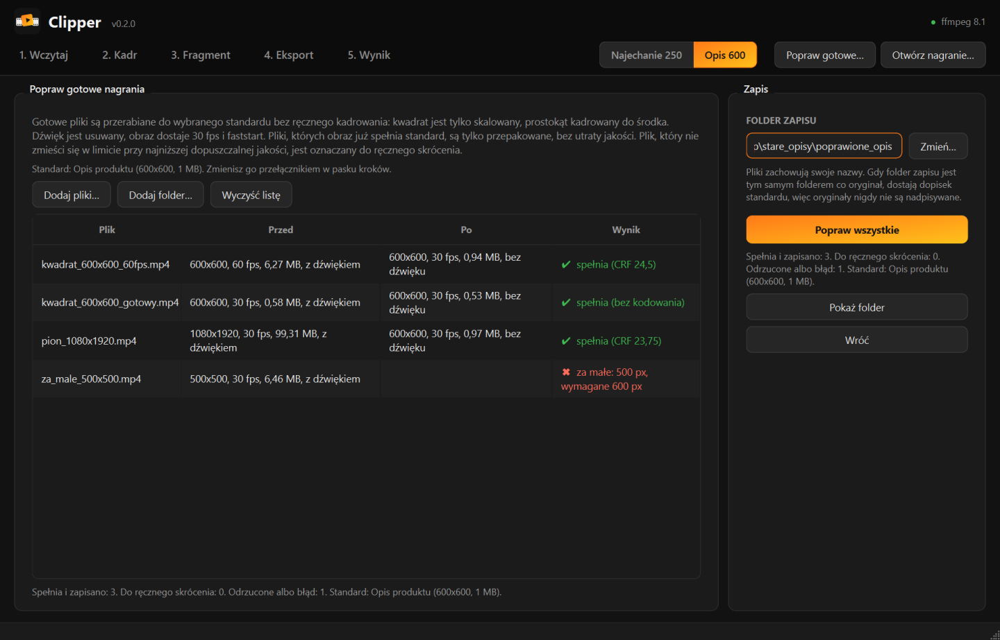

<p align="center">
  
</p>

<p align="center">
  <b>Z surowego nagrania produktu do gotowego wideo dla sklepu.</b><br>
  Dwa standardy: wideo po najechaniu (250x250, 0,5 MB) i wideo w opisie produktu (600x600, 1 MB).<br>
  Kwadrat, 30 fps, H.264, bez dźwięku, faststart. Zawsze w standardzie, bez zgadywania.
</p>

<p align="center">
  <a href="https://github.com/vTomsonek/AOWcloud-Clipper/releases/latest"></a>
  
  
  
  <a href="LICENSE"></a>
</p>

<p align="center">
  
</p>

> **In English:** AOWcloud Clipper is a Windows desktop app that turns any product recording
> (mp4, mov, webm, portrait or landscape) into a short, silent, looping square MP4 for an
> e-commerce shop, in one of two strict standards: 250x250 / 0.5 MB for hover videos in product
> tiles, or 600x600 / 1 MB for videos in product descriptions. H.264 High, 30 fps, faststart,
> no rotation metadata, hard size cap. You pick the square crop and the fragment, it finds the best
> x264 quality that fits the limit and verifies the result with ffprobe. A batch mode fixes
> existing videos (drops audio, 30 fps, faststart, re-encodes only when needed). UI in Polish.

## Spis treści

- [Pobierz i uruchom](#pobierz-i-uruchom)
- [Standardy](#standardy)
- [Jak się tego używa](#jak-się-tego-używa)
- [Popraw gotowe nagrania](#popraw-gotowe-nagrania)
- [Jak program dobiera jakość](#jak-program-dobiera-jakość)
- [Budowanie ze źródeł](#budowanie-ze-źródeł)
- [Testy](#testy)
- [Struktura projektu](#struktura-projektu)
- [Licencja](#licencja)

## Pobierz i uruchom

1. **Pobierz** [`AOWcloud-Clipper.exe`](https://github.com/vTomsonek/AOWcloud-Clipper/releases/latest/download/AOWcloud-Clipper.exe)
   z [Releases](https://github.com/vTomsonek/AOWcloud-Clipper/releases/latest). To jeden plik,
   bez instalacji i bez Pythona.
2. **Zainstaluj ffmpeg** (raz na komputerze). W PowerShell:
   ```
   winget install ffmpeg
   ```
   Potem zamknij okno PowerShell. Jeśli ffmpeg nie będzie dostępny, program sam to powie
   i poda to polecenie.
3. **Uruchom** dwuklikiem.

> [!NOTE]
> Plik nie ma podpisu cyfrowego, więc przy pierwszym uruchomieniu Windows może pokazać okno
> „System Windows ochronił ten komputer”. Kliknij **Więcej informacji**, a potem
> **Uruchom mimo to**. Niektóre antywirusy ostrzegają przed programami spakowanymi PyInstallerem:
> to fałszywy alarm, plik można dodać do wyjątków.

Program działa offline, pliki nie wychodzą poza komputer. Aktualizacja to podmiana pliku .exe.
Ustawienia (standard, folder zapisu, rozmiar okna) zostają w profilu Windows każdego użytkownika.

## Standardy

Standard wybiera się przełącznikiem „Najechanie 250 / Opis 600” w pasku kroków. Jest widoczny przez cały czas pracy,
a program pamięta ostatni wybór. Podpowiedź przełącznika pokazuje pełne parametry.

| | **Wideo po najechaniu** | **Opis produktu** |
|---|---|---|
| Gdzie gra | kafelek na liście produktów, po najechaniu myszką (ok. 255 px na komputerze, 170 px na telefonie) | opis produktu na pełną szerokość telefonu (ok. 375 px, realnie ponad 600 px na gęstych ekranach), ładuje się po przewinięciu |
| Obraz | kwadrat **250x250 px** | kwadrat **600x600 px** |
| Waga | **najwyżej 524 288 B** (0,5 MB) | **najwyżej 1 048 576 B** (1 MB) |
| Min. krótszy bok źródła i kadru | 250 px | 600 px |
| Jakość (CRF) | start 20, próg 27 | start 22, próg 27,5 |
| Podgląd | kafelek 250x250 | ekran telefonu 375 px |
| Dopisek nazwy pliku | `_250` | `_opis` |

Wspólne dla obu: MP4 z `-movflags +faststart` (atom `moov` przed `mdat`), 30 fps, H.264 profil
High, yuv420p, bez ścieżki audio, bez metadanych obrotu (panel czyta wymiary przez ffprobe)
i bez metadanych źródła.

Program **nigdy nie powiększa obrazu**: nagranie, którego krótszy bok (po uwzględnieniu obrotu
z telefonu) jest mniejszy niż wymaga standard, jest odrzucane z komunikatem, np. „Nagranie jest za
małe: 500x500 px. Krótszy bok musi mieć co najmniej 600 px, żeby kadr 600x600 nie był
powiększany. (…) To nagranie nadaje się do standardu „Wideo po najechaniu (250x250, 0,5 MB)”.”

Każdy eksport jest na koniec sprawdzany ffprobe według wybranego standardu. Plik, który nie spełnia
choćby jednego warunku, **nie jest zapisywany** do folderu i nie wygląda na gotowy. Ekran wyniku
mówi wprost, który standard plik spełnia.

> Wszystkie liczby i teksty standardu są w jednym wpisie w
> [`clipper/standard.py`](clipper/standard.py). Trzeci standard to dopisanie jednego `VideoStandard`.

## Jak się tego używa

| Krok | Co robisz |
|---|---|
| **1. Wczytaj** | Przeciągnij nagranie na okno albo „Otwórz nagranie…”. Za małe nagrania są od razu odrzucane z komunikatem. |
| **2. Kadr** | Pomarańczowa ramka zawsze 1:1, nie mniejsza niż wymiar standardu w pikselach źródła. Przeciągnij, żeby przesunąć, ciągnij za róg albo kręć kółkiem, żeby zmienić rozmiar. Obok podgląd na żywo: kafelek 250x250 albo ekran telefonu. |
| **3. Fragment** | Dwa uchwyty na osi czasu, odtwarzanie w pętli bez dźwięku, jak w sklepie. Pasek „≈ 0,37 / 0,50 MB” (albo „/ 1,00 MB”) na bieżąco szacuje wagę. |
| **4. Eksport** | Kodowanie w tle z paskiem postępu i przyciskiem „Anuluj eksport”. |
| **5. Wynik** | Gotowy plik w podglądzie, parametry i zielone „Spełnia standard: …” albo czerwona lista problemów. „Pokaż w folderze” otwiera Eksplorator. |

<p align="center">
  
</p>

<details>
<summary><b>Standard „Wideo po najechaniu” (zrzuty)</b></summary>

<p align="center">
  
  
</p>
</details>

Gdy fragment jest za długi na limit nawet przy najniższej dopuszczalnej jakości, program
nie koduje gorzej, tylko mówi, o ile skrócić. Przycisk **„Skróć automatycznie”** robi to sam.

<p align="center">
  
</p>

**Płynna pętla.** Program porównuje pierwszą i ostatnią klatkę fragmentu i ostrzega, gdy w pętli
będzie widać skok. Opcja **„Płynna pętla (przenikanie)”** przenika ostatnie 0,5 s w początek
fragmentu, więc przejście jest niewidoczne.

**Skróty klawiszowe**

| Klawisz | Działanie |
|---|---|
| `Spacja` | odtwarzaj / pauza (pętla fragmentu) |
| `I` / `O` | początek / koniec fragmentu w bieżącym miejscu |
| `←` / `→` | klatka wstecz / naprzód |
| `Ctrl+O` | otwórz nagranie |
| `Ctrl+E` | eksportuj |

## Popraw gotowe nagrania

Tryb do stopniowej wymiany starych nagrań (przycisk **„Popraw gotowe…”** w pasku kroków). Dodajesz
kilka plików albo cały folder (albo przeciągasz je na okno), a program przerabia je do wybranego
standardu **bez ręcznego kadrowania**:

- plik, którego obraz **już spełnia standard** (np. 600x600, 30 fps, H.264 High, yuv420p), jest
  tylko **przepakowany bez ponownego kodowania**: znika dźwięk i metadane, dochodzi faststart,
  jakość zostaje bez zmian. To typowy przypadek starych nagrań opisów (98% ma niepotrzebny dźwięk,
  68% nie ma faststart),
- pozostałe są kodowane: kwadrat jest tylko skalowany, prostokąt kadrowany do środka, 60 fps
  zamieniane na 30, cały plik jako fragment, ten sam dobór CRF co przy eksporcie,
- plik, który nie mieści się w limicie przy progowej jakości, jest oznaczany **do ręcznego
  skrócenia** (z podpowiedzią, o ile) i nie jest kodowany gorzej,
- za małe nagrania są odrzucane z podaniem wymaganego minimum.

Na koniec tabela: plik, przed (wymiary, fps, waga, dźwięk), po, wynik. Pełny opis wyniku jest
w podpowiedzi komórki. Zapisywane są tylko pliki zgodne ze standardem. Domyślny folder zapisu to
`poprawione_opis` (albo `poprawione_250`) obok pierwszego pliku. Pliki zachowują nazwy, więc łatwo
podmienić je w panelu, a oryginały nigdy nie są nadpisywane.

<p align="center">
  
</p>

## Jak program dobiera jakość

Zasada: **najlepsza jakość przy najmniejszej wadze, w twardym limicie standardu.** Algorytm jest
ten sam dla obu standardów, różnią się tylko wymiar, limit i progi CRF.

```
trim (fragment) → crop (kadr) → scale=N:N:flags=lanczos → fps=30 → format=yuv420p
        │
        ▼  plik pośredni FFV1 (bezstratny, źródło dekodowane tylko raz)
        │
        ▼  libx264 -preset veryslow -tune film -crf N, jedna klatka kluczowa, faststart
```

1. Próba przy **CRF startowym** (20 dla 250x250, 22 dla 600x600). Jeśli plik mieści się
   w limicie, koniec: lepszej jakości nie widać, a mniejszy plik szybciej się ładuje.
2. Jeśli jest za duży, program szuka **najniższego CRF, który się mieści**: zgaduje z reguły
   „+6 CRF to mniej więcej połowa wagi”, a potem zawęża przedział interpolacją logarytmiczną.
   Zwykle 2 do 4 prób.
3. Powyżej **CRF progowego** (27 dla 250x250, 27,5 dla 600x600) obraz jest już za słaby. Wtedy
   program wraca do kroku „Fragment” z komunikatem, np. „Skróć fragment o ok. 27,0 s (do ok.
   33,0 s)”, liczonym z bitrate przy progowym CRF.

<details>
<summary><b>Przyjęte progi</b></summary>

| Próg | 250x250 | 600x600 | Dlaczego |
|---|---|---|---|
| CRF startowy | 20 | 22 | niewidoczna utrata jakości (patrz kalibracja niżej) |
| CRF progowy | 27 | 27,5 | powyżej widać rozmycie i bloki na krawędziach produktu |
| Min. bok źródła i kadru | 250 px | 600 px | obraz nigdy nie jest powiększany |
| Dokładność CRF | 0,5 | 0,5 | różnica 0,5 CRF jest niewidoczna |
| Wystarczająco blisko | 96% limitu | 96% limitu | dalsze szukanie nie da widocznej różnicy |
| Min. fragment | 1 s | 1 s | krótsza pętla miga |
| Ostrzeżenie o skoku w pętli | różnica > 10% | różnica > 10% | płynne ujęcia dają 2 do 6% |
| Przenikanie | 0,5 s | 0,5 s | wystarcza, żeby ukryć skok |
</details>

<details>
<summary><b>Kalibracja progów dla 600x600 (pomiary)</b></summary>

Progu z 250x250 nie skopiowano: przy większej rozdzielczości artefakty wyglądają inaczej.
Kalibracja na 6 nagraniach: 5 prawdziwych nagraniach produktów z telefonu (pion i poziom 1080p,
jedno HEVC 720x960, w tym bardzo ruchliwe ujęcie z pianą) i 1 syntetycznym. Z każdego 8 s,
kadr kwadratowy, kodowanie przy CRF 18 do 32 w obu rozdzielczościach, pomiar **VMAF w modelu
telefonu** względem bezstratnego oryginału.

Bezwzględny VMAF przy tak małych obrazach zależy od treści (jedno nagranie ma 60 pkt już przy CRF 18),
więc porównywany jest **spadek względem CRF 18**:

- **próg 250x250 (CRF 27)** daje spadek 0,6 do 2,9 pkt, mediana **ok. 1,7 pkt**,
- przy **600x600** ten sam spadek wypada między CRF 27 (mediana 1,4) a CRF 28 (mediana 1,95), stąd
  **CRF 27,5**. Większy obraz wybacza nieco więcej, więc próg 27 byłby niepotrzebnie ostrożny.
  Oględziny powiększonych wycinków potwierdzają: przy 27,5 drobna faktura (bąbelki piany) zostaje,
  przy 32 wyraźnie się rozmywa,
- **start 600x600 (CRF 22)**: najwyżej 0,5 pkt spadku (niewidoczne), a plik o ok. 22% lżejszy niż
  przy CRF 20. Opisy oglądane są głównie na telefonach, często na danych komórkowych, więc waga
  ma znaczenie.

Bitrate przy CRF 27 dla 600x600 na prawdziwych nagraniach: 0,62 do 0,92 Mb/s (1 MB to ok. 9 do 13 s),
bardzo ruchliwe ujęcie 1,96 Mb/s (ok. 4 s).
</details>

<details>
<summary><b>Dlaczego takie ustawienia x264 (pomiary)</b></summary>

Pomiary na nagraniu testowym 10 s (kadr 1080x1080 → 250x250), SSIM względem bezstratnego
pliku pośredniego.

- **`-preset veryslow`**: przy tak małych obrazach czas kodowania nie gra roli, a wolniejszy preset
  daje mniejszy plik przy tej samej jakości.
- **`-tune film`**: przy równej wadze (~303 KB) film i brak tune wychodzą praktycznie tak samo
  (SSIM 0,9628 i 0,9626), a film lepiej trzyma fakturę materiału z kamery. `-tune ssim` wypada
  lepiej w metrykach (0,9645) tylko dlatego, że wyłącza optymalizacje psychowizualne. Autorzy x264
  zalecają go wyłącznie do testów porównawczych, na ekranie daje „plastikowy” obraz.
- **Jedna klatka kluczowa na cały plik** (`-g` = liczba klatek, `-sc_threshold 0`, zamknięty GOP):
  pętla w `<video loop>` zawsze startuje od klatki 0. Plik o 2% mniejszy niż przy domyślnym GOP
  i o 12% mniejszy niż przy GOP 1 s, przy tej samej jakości.
- **Dwa przebiegi: odrzucone.** Przy danej wadze dają tę samą jakość co CRF, a przy klipach
  kilkunastosekundowych mocno chybiają: cel 303 KB dał plik **404 KB (+33%)**. CRF z doborem
  trafia w limit dokładnie.
</details>

<details>
<summary><b>Szacunek wagi na żywo, weryfikacja, pliki tymczasowe</b></summary>

**Szacunek.** Po wczytaniu, po każdej zmianie kadru i po zmianie standardu program w tle koduje
całe nagranie przy startowym i progowym CRF i zapamiętuje rozmiar każdej klatki. Waga dowolnego
fragmentu to suma jego klatek (plus klatka I na początku i nagłówki MP4), więc przesuwanie
uchwytów aktualizuje pasek natychmiast. W testach szacunek różnił się od wyniku o 0,4 do 3,5%.

**Weryfikacja.** ffprobe sprawdza kontener MP4, jedną ścieżkę wideo, wymiary standardu, 30 fps
(`r_frame_rate` i `avg_frame_rate`), h264 High, yuv420p, brak audio i innych ścieżek, wagę
w limicie standardu, brak metadanych obrotu (Display Matrix i tag `rotate`) i czas trwania.
Dodatkowo program czyta nagłówki atomów MP4 i sprawdza, czy `moov` jest przed `mdat`.

**Obrót z telefonu.** ffmpeg stosuje go przed filtrami, a gotowy plik nie ma metadanych obrotu.
Podgląd w oknie pokazuje obraz w tej samej orientacji co eksport.

**Pliki tymczasowe** powstają w `%TEMP%\aowclipper_xxxx`, są sprzątane po eksporcie i przy
zamknięciu programu. Pozostałości po awarii (starsze niż 6 h) znikają przy następnym starcie.
</details>

## Budowanie ze źródeł

Potrzebny Python 3.12 (tylko do budowania) i ffmpeg w PATH:

```
winget install Python.Python.3.12
winget install ffmpeg
```

Zbudowanie `dist\AOWcloud Clipper.exe` (jeden plik, ok. 55 MB, bez okna konsoli):

```
powershell -ExecutionPolicy Bypass -File .\build.ps1
```

Skrypt tworzy `.venv`, instaluje [`requirements.txt`](requirements.txt) (PySide6, PyInstaller,
Pillow), rysuje ikonę i uruchamia PyInstaller. Podgląd wideo korzysta z wbudowanego w Qt backendu
FFmpeg, więc obsługuje mp4, mov, webm, mkv i HEVC z telefonów bez dodatkowych kodeków Windows.

Uruchomienie bez budowania:

```
.venv\Scripts\python.exe main.py
```

## Testy

```
.venv\Scripts\python.exe -m tests.test_pipeline
```

Skrypt generuje ffmpeg nagrania testowe (`testsrc2` z drganiami jak z ręki, lekkim szumem
matrycy i dźwiękiem) i przepuszcza je przez całą logikę bez interfejsu, w obu standardach,
łącznie z trybem poprawiania. Na koniec porównuje wyniki standardu 250x250 z wersją sprzed
dodania drugiego standardu (v0.1.1): x264 jest deterministyczny, więc muszą się zgadzać co do bajta.
Ostatni raport: [`tests/wyniki_testow.txt`](tests/wyniki_testow.txt).

| Nagranie | 250x250, 0,5 MB | 600x600, 1 MB |
|---|---|---|
| pionowe 1080x1920, 10 s | CRF 20, 0,33 MB, spełnia | CRF 23,75, 0,97 MB, spełnia |
| poziome 1920x1080 .mov, fragment 8 s z przenikaniem | CRF 20, 0,24 MB, spełnia | CRF 22, 0,97 MB, spełnia |
| z telefonu: 1920x1080 z obrotem 90° | CRF 20, 0,39 MB, spełnia | CRF 24,75, 0,97 MB, spełnia |
| za małe 200x200 | odrzucone (min. 250 px) | odrzucone (min. 600 px) |
| za małe 500x500 | CRF 20, 0,29 MB, spełnia | odrzucone (min. 600 px), z podpowiedzią standardu 250x250 |
| za długie 60 s, cały plik | wstrzymane: skróć o ok. 27,0 s | wstrzymane: skróć o ok. 43,0 s (do 17,0 s) |
| za długie 60 s, fragment | 33 s: CRF 26,75, 0,49 MB; 20 s: CRF 22,25, 0,49 MB | 10 s: CRF 24,25, 0,97 MB, spełnia |
| **popraw:** kwadrat 600x600, 60 fps, z dźwiękiem | spełnia (CRF 20) | spełnia (CRF 24,5) |
| **popraw:** gotowy 600x600 30 fps z dźwiękiem, bez faststart | spełnia (CRF 20) | spełnia, **bez kodowania** (0,58 → 0,53 MB) |
| **popraw:** za długie 60 s | do ręcznego skrócenia o 27,0 s | do ręcznego skrócenia o 43,0 s |

Regresja 250x250: wszystkie 7 wyników (rozmiary plików, wybrane CRF i komunikaty) identyczne
z v0.1.1.

[`tests/smoke_gui.py`](tests/smoke_gui.py) uruchamia okno (`SMOKE_STD=opis` wybiera standard opisu,
folder zamiast pliku uruchamia tryb poprawiania), eksportuje i zapisuje zrzuty ekranu (stąd obrazy
w tym README). Nie zmienia ustawień użytkownika.

## Struktura projektu

```
main.py                    start, sprawdzenie ffmpeg
clipper/standard.py        standardy sklepu (VideoStandard) i wspólne progi
clipper/core.py            ffprobe, filtry, dobór CRF, szacunek, weryfikacja, poprawianie (bez Qt)
clipper/ui/main_window.py  okno, przełącznik standardu, przepływ pracy, tryb poprawiania
clipper/ui/widgets.py      kadrowanie, podgląd (kafelek, telefon), oś czasu, pasek wagi, kroki
clipper/ui/workers.py      wątki: analiza, sprawdzenie pętli, eksport, poprawianie
clipper/ui/theme.py        wygląd (styl rodziny AOWcloud)
clipper/ui/icon.py         logo rysowane w kodzie
build.ps1                  budowanie .exe
tools/                     generowanie ikony .ico
tests/                     generator nagrań, test logiki, test okna
```

## Licencja

Kod: [Apache License 2.0](LICENSE). Plik .exe zawiera komponenty zewnętrzne na własnych
licencjach (m.in. Qt/PySide6 i biblioteki FFmpeg na LGPL), szczegóły w [NOTICE](NOTICE).
Do kodowania program używa ffmpeg zainstalowanego osobno przez użytkownika.
